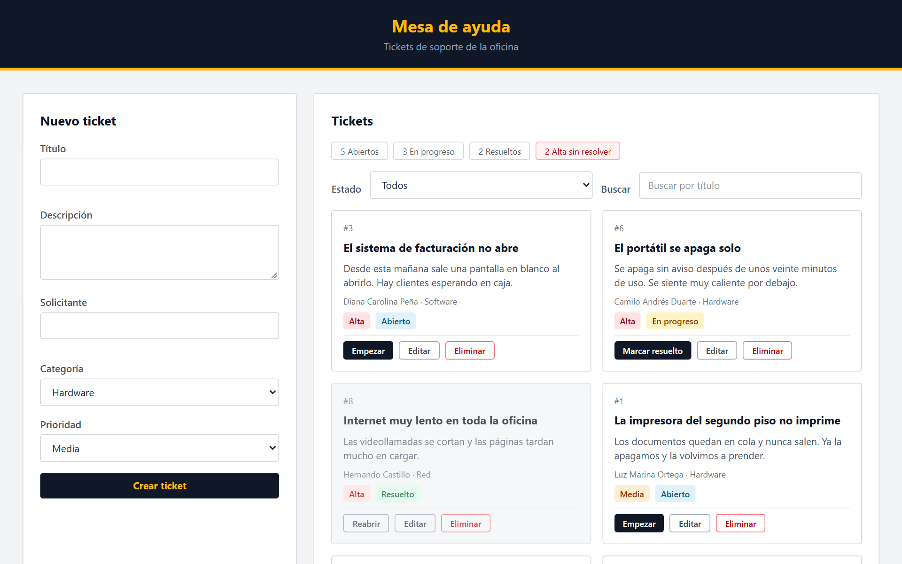

# 🛠️ Mesa de ayuda · Tablero de tickets de soporte


Tablero para que el equipo de soporte de una oficina gestione los problemas que reporta la gente (la impresora no imprime, el correo no abre…). Cada problema es un **ticket**. Está hecho con **HTML, Tailwind y JavaScript sin frameworks**, y se conecta a una **API REST** que corre en tu propio computador con json-server.

<p align="center">
  
</p>

## ✨ Qué hace

- 📋 **Lista los tickets** con su prioridad, categoría y estado.
- ➕ **Crea tickets** con validación de los campos obligatorios.
- 🔄 **Cambia el estado**: Abierto → En progreso → Resuelto, y permite **reabrir** uno resuelto.
- ✏️ **Edita** cualquier ticket desde el mismo formulario.
- 🗑️ **Elimina** tickets con confirmación.
- 🔍 **Filtra** por estado y **busca** por título.
- 📊 **Resumen** de abiertos, en progreso, resueltos y los de prioridad alta sin resolver.
- ⬆️ **Ordena por prioridad**: los de prioridad alta aparecen primero.
- ⏳ Mensajes de carga y de error cuando la API tarda o no responde.

## 🚀 Cómo correrlo

Necesitas [Node.js](https://nodejs.org/es/download). En la carpeta del proyecto:

```bash
npm install
npm run api
```

Abre http://localhost:3000 en el navegador. Deja la terminal abierta: si la cierras, la API se apaga.

| Comando | Qué hace |
|---|---|
| `npm run api` | Levanta la API y sirve la página en http://localhost:3000 |
| `npm run api:lento` | Lo mismo, pero cada respuesta tarda 1,5 s (sirve para ver el estado de carga) |
| `npm run reiniciar` | Devuelve `db.json` a los diez tickets iniciales |

> Tailwind se carga por CDN, así que necesitas internet para que se vean los estilos.

## 🔌 La API

| Método | Ruta | Qué hace |
|---|---|---|
| `GET` | `/tickets` | Devuelve todos los tickets |
| `POST` | `/tickets` | Crea un ticket |
| `PATCH` | `/tickets/:id` | Cambia solo algunos campos (lo uso para el estado) |
| `PUT` | `/tickets/:id` | Reemplaza el ticket completo (lo uso al editar) |
| `DELETE` | `/tickets/:id` | Elimina el ticket |

## 🗂️ Estructura

```
public/index.html    ← la página (maquetada con Tailwind)
public/app.js        ← toda la lógica: fetch, pintar tarjetas, formulario, filtros
db.semilla.json      ← los diez tickets iniciales
preparar-db.js       ← crea o reinicia db.json
ENUNCIADO.md         ← el enunciado del trabajo
RESPUESTAS.md        ← mis respuestas a las preguntas de repaso
```

## 📚 Lo que practiqué

- Consumir una API REST con `fetch` y `async/await`: GET, POST, PATCH, PUT y DELETE.
- La diferencia entre **PUT** y **PATCH** (la explico con un experimento en [RESPUESTAS.md](RESPUESTAS.md)).
- Crear elementos del DOM desde JavaScript y volver a pintar la pantalla a partir del estado.
- Validar formularios y mostrar errores al usuario.
- Maquetar con clases de **Tailwind**.

El trabajo se hizo por pasos (del Paso 0 al Paso 6, más algunos extras) y cada uno tiene su commit.

---

Hecho por **David Camilo Colmenares**, estudiante de Ingeniería de Sistemas en la UFPS. [GitHub](https://github.com/Camilo0812A)
